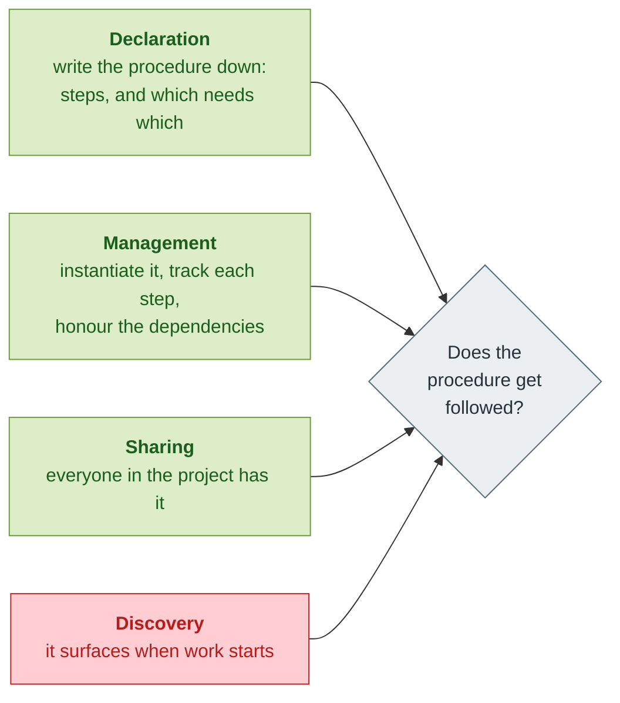
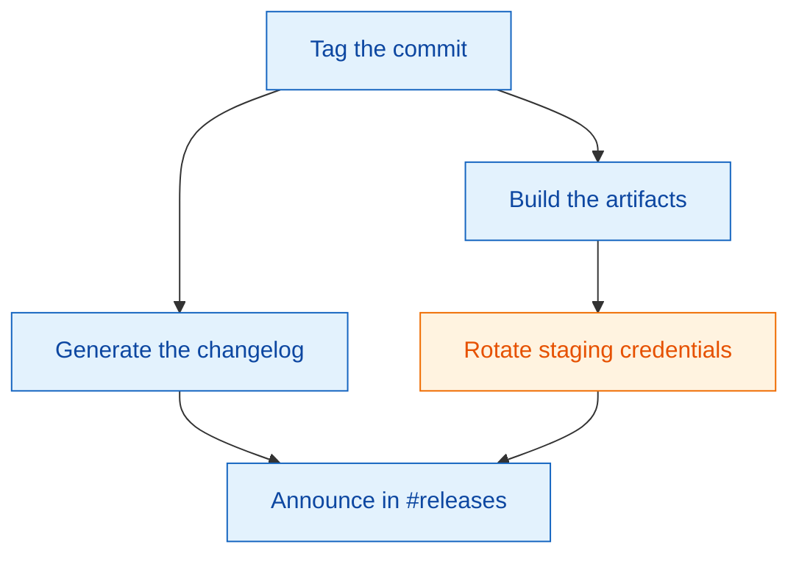
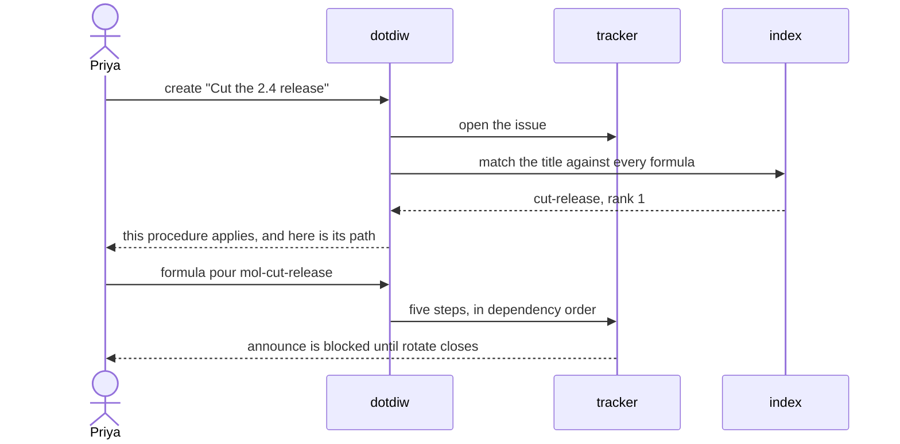
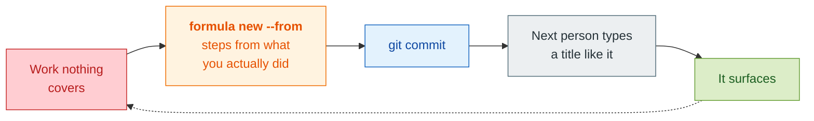

# dotdiw

**The procedure that applies to your work should find you. You should not have to
know it exists.**

---

## A Thursday

Priya cuts the 2.4 release. She tags the commit, builds the artifacts, generates
the changelog from the tag range, announces it in `#releases`. Good release.

She does not rotate the staging credentials.

That step exists. It is step four of a document written nineteen months ago by
someone who has since left, in `docs/release-process.md`, a file Priya has never
opened because she has never had a reason to know it is there. Nobody finds a
runbook by needing it. You find a runbook by already knowing its name.

Three weeks later an agent is asked to ship 2.5. It tags, builds, writes a
changelog, announces. It does not rotate the staging credentials either — same
file, same reason. On its way past it writes `docs/how-to-release.md`, so the
project now has two runbooks neither of which anyone will open.

**The procedure was never missing. It just never surfaced.**

---

## Four things have to work



Three of them are already solved. A file in the repository declares the
procedure, an issue tracker that honours dependencies manages it, and git shares
it. If you have no tracker, dotdiw brings one: a single file under your home
directory. If you already use one, an adapter lets dotdiw use it instead.

**Discovery is the one nothing provides**, and it decides whether the other three
matter: nobody follows a procedure they never find.

`dotdiw` adds discovery and puts the tracker behind one command, so no task ever
requires typing the tracker's own name.

---

## The same Thursday, with dotdiw

### 1. Someone wrote the procedure down once

Not as prose. As a file that can be matched against a title and poured into
steps.

```toml
# services/billing/cut-release.formula.toml
formula = "mol-cut-release"
description = """Cut and publish a release: tag, build, changelog, rotate the
staging credentials, announce. Use when shipping a version to users."""
examples = [
  "Cut the 2.4 release",
  "Ship v3 to production",
  "Get billing out to prod this afternoon",
]
verify-using = [
  "run:git describe --tags --exact-match",
  "git+https://git.example.invalid/mapleline/billing.git#services/billing/CHANGELOG.md",
  "https://chat.example.invalid/mapleline/releases",
]

[[steps]]
id = "tag"
title = "Tag the commit"

[[steps]]
id = "build"
title = "Build the artifacts"
needs = ["tag"]

[[steps]]
id = "notes"
title = "Generate the changelog from the tag range"
needs = ["tag"]

[[steps]]
id = "rotate"
title = "Rotate the staging credentials"
needs = ["build"]

[[steps]]
id = "announce"
title = "Announce in #releases"
needs = ["notes", "rotate"]
```

It lives **next to the thing it is about** — `services/billing/`, not a folder of
its own. The path is matched too, so `services/billing/cut-release` already
answers to "billing" and "release" without the description repeating them.



The step Priya missed is the orange one. It is not buried in paragraph four of
anything. It is a node with an edge into `announce`, which means **the release
cannot be announced while it is open.**

`verify-using` names the means to prove that the run did what the formula
claims, one to a line: a command after `run:`, a file in a repository as a
`git+https://` or `git+ssh://` URL with its path after `#`, or a link. dotdiw
shows them when the formula is poured, the tracker keeps them on the root, and
`dotdiw check` names any it cannot read, any longer than a line, and a file of
this repository that git does not track. Before the root closes, whoever ran
the release proves it with them: runs the command, reads the file, opens the
link.

### 2. Priya starts her work the way the project says to

```console
$ dotdiw create "Cut the 2.4 release"
✓ Created issue: mapleline-4k2m — Cut the 2.4 release

📜 Formulas that may apply:
  cut-release  Cut and publish a release: tag, build, changelog, rotate the s…
               services/billing/cut-release.formula.toml
  Run it: dotdiw formula pour mol-cut-release
```

She was not searching. She did not know the formula existed. She typed what she
was about to do, which she was going to type anyway.



### 3. She instantiates it

```console
$ dotdiw formula pour mol-cut-release
✓ Poured mol: created 6 issues
  Root issue: mapleline-7qgd
Verify using:
  run:git describe --tags --exact-match
  git+https://git.example.invalid/mapleline/billing.git#services/billing/CHANGELOG.md
  https://chat.example.invalid/mapleline/releases
```

Tracked, ordered and durable, in the tracker and not in anyone's head. When she
tries to close `announce` early:

```console
$ dotdiw close mapleline-9f1x
cannot close blocked issue: mapleline-9f1x is blocked by [mapleline-3dxa]
```

**That is the whole mechanism.** The procedure found her because she named her
work, and the dependency she did not know about stopped her anyway.

---

## And when nothing matches?

That is the other half, and it is where procedures come from.

```console
$ dotdiw create "Handle the Stripe webhook backlog"
✓ Created issue: mapleline-8d1k — Handle the Stripe webhook backlog
```

Silence. No formula covers this. So you do the work — and the moment you notice
you have done something you will do again:

```console
$ dotdiw formula new "Handle the Stripe webhook backlog" --from mapleline-8d1k
✓ Wrote handle-stripe-webhook-backlog.formula.toml
  Steps taken from mapleline-8d1k, in the order the work was done.

  One thing left, and it is discoverable:
    the description   the situation, and when to reach for it

  Then:  git add handle-stripe-webhook-backlog.formula.toml && git commit
         dotdiw check
```

`--from` reads the issue's own children and the dependencies between them, and
writes them out as steps **in the order you actually did them**. The highest
fidelity capture there is: the procedure as carried out, not as remembered
afterwards.

Commit it, and the next person — or the next agent — has it. That is sharing;
there is nothing else to publish and nowhere else to put it.



---

## The two conventions

A project **states** these. They are not habits anyone holds — they bind whoever
shows up, human or agent, including everyone who was not there when they were
written. `dotdiw init` writes them into the files agents read.

### Work starts at one declared moment

Every task and subtask begins with `dotdiw create`. That declaration *is* the
mechanism, not a note about one: it is what gives discovery a hook that always
fires. Start by cutting a branch instead and nothing surfaces — the discipline
was skipped, not the mechanism broken.

### Procedures are described to be found

A description is the only thing standing between what someone calls their work
and the procedure that fits it. It names the situation and when to use it, in the
words people use for the work:

| | |
|---|---|
| **no** | `description = "Cut Release"` |
| **yes** | `description = "Cut and publish a release: tag, build, changelog, rotate the staging credentials, announce. Use when shipping a version to users."` |

The first is a label on a mechanism. The second **is** the mechanism.

### Both are checked, not hoped for

```console
$ dotdiw check
3 problems:
  services/billing/cut-release.formula.toml  description is 4 words -- write a sentence
                                             naming the situation, and when to use it
  docs/rotate-secrets.formula.toml           example "The Stripe key is in a public gist"
                                             does not retrieve it
  ops/incident.formula.toml                  not committed, so nobody else can see it
```

Each formula carries example titles, and `check` runs every one of them through
the ranker **with that example removed from the index first**. A formula its own
examples cannot retrieve is reported as undiscoverable — because it is. Leave the
example in and the test proves only that an indexed string can find itself.

`create` runs the same check quietly every time, so the moment that fires for
discovery is the moment that enforces.

---

## How it works

**Formulas are found with `git ls-files '*.formula.toml'`.** Anywhere in the
tree. The suffix is the convention, not the directory — nothing is registered,
nothing is copied into a config folder, and a formula you did not commit is
invisible. That is the sharing convention made mechanical rather than advisory.

**Retrieval is SQLite's FTS5**, which the interpreter already ships: bm25 ranking
and a porter stemmer, so a word is worth what it is distinctive and "failing"
reaches "fail". Nothing is installed and nothing is hand-rolled.

**The project's own prose is indexed alongside the formulas, and never
returned.** It is there so the ranker can tell which words are everyday ones
*here*. Against four documents, "version" looked distinctive enough to pull up
the release formula for a Go toolchain bump. Against twenty-two, it does not.

**Silence is a fraction, not a score.** A formula shows when it accounts for at
least 0.15 of what is distinctive about your title. A ratio rather than a
threshold, because bm25's scale depends on how much text a project has — an
absolute floor calibrated on a documented project silences every match in a
project with one formula and a two-line README, where bm25's idf is zero by
construction.

---

## What was measured, including what failed

`measurements/` holds the apparatus behind every number here: eleven domain
fixtures, four project states, scorers that read ground truth from an invocation
log and from git rather than from what an agent claimed, eleven retrieval sweeps,
and the scripts that ran forty-four blind agent runs.

**It changes behaviour, and only through the files agents read.** Across eleven
projects, agents given a job and told nothing about the tooling:

| | before | after |
|---|---|---|
| left formulas where they belonged | 0 of 5 | 11 of 11 |
| used `create` for the work | 2 of 5 | 11 of 11 |
| ran `check` | 0 of 5 | 11 of 11 |
| wrote a formula for uncovered work | 0 of 33 | 8 of 11 |
| committed the formula they wrote | 0 of 9 | 7 of 9 |

Every fix that moved those numbers landed in `AGENTS.md`. Every runtime nudge
changed nothing. **Declared and checkable works; reminding does not.**

**And the limit.** Pooled to 56 formulas, retrieval scales and silence does not:

| formulas | right formula in top 3 | titles nothing covers, left silent |
|---|---|---|
| 3 | 94% | 88% |
| 12 | 96% | 45% |
| 30 | 95% | 24% |
| 56 | 93% | **5%** |

At fifty-six formulas, titles describing work no formula covers retrieve
something anyway — and the hits are not bugs. A formula for draining a node
shares *replace* and *waiting* with "replace the waiting room chairs", because
draining a node means replacing it and waiting for connections to finish. Right
document by word overlap, wrong procedure for the work.

Raising the threshold costs about one real retrieval per coincidence suppressed.
Requiring two shared words is the same curve. A local embedding model gives the
first rule whose silence survives scale — 0.91 at fifty-six formulas — but only
at 0.55 recall instead of 0.93.

**So this holds at tens of procedures.** Telling "replace a chair" from "replace
a node" needs something that reads the title rather than counting its words.
Whether that is a limit of the design or only of the rules tried against it is
unresolved: a local model that *judges* rather than scores installs the same way
and has not been tested.

`measurements/README.md` is specific about which claims have numbers behind
them and which do not.

---

## The promise, written down

dotdiw is described in the discipline it asks of a project, as files that
validate against the schemas they declare. Each is thin where it should be and
owns only what is its own.

- `product.yaml` -- the promise: what may be relied on, by whom, under what
  conditions and boundaries, with the evidence that it was kept and the ways
  it could look kept while broken.
- `praxis.yaml` -- the lived capability that keeps it: what whoever works here
  must notice, judge and do, what proves it, what would betray it, and the
  lawful lifecycles of a piece of work and of a formula.
- `carrier.yaml`, `reliant-enactments/` -- who may stand in the product's
  position, and one real occasion of reliance.
- `poa/product-model.yaml` and `operation-idl.json` -- the governed source and
  the operation algebra derived from it: forty-four operations, each traced
  to a duty, a step and a lawful lifecycle transition, ten of them the
  tracker interface an adapter answers. Each step and journey of the model
  declares, in its operation block, what its operation takes, returns and
  calls, and the tracker and git commands it runs. `poa derive` writes the
  IDL from the model, and `poa/complete-idl.py` writes in what derive leaves
  out: those operation blocks, the records the responses share, the
  dependencies, the command-line bindings from `interface-bindings.cli.json`,
  one implementation binding per body and per adapter from
  `implementation-bindings.json`, and the witness contract's sections from
  `contracts/named-work-found-its-procedure.bindings.json`. It also writes into
  `dotdiw` both doors, the file a tracker starts from, and one class for every
  request, response and shared record of the IDL, which the bodies and the
  adapters inside it are typed by.
- `promise_bindings.py` -- every operation bound to its one body in `dotdiw`,
  under the IDL's name, and each operation of the tracker interface to the
  adapter that answers it. `dotdiw` is shaped by it: one function per
  operation, nothing shared between them but infrastructure, every operation
  invoked through one door generated from the IDL, which holds the request
  and the response to their types; the tracker behind a second door of the
  same making, where an adapter answers in records and nothing but an
  adapter runs a tracker; and `main()` only routes. `test_promise.py` holds
  the file to that from its source alone, both doors and the types
  regenerated and compared; `test_tracker.py` runs the one scenario that defines an adapter
  against every adapter present.
- `contracts/`, `events/` -- the witness contract: which observed events are
  allowed to count as "work was named and its procedure surfaced", proved
  against this tool's own 0.2.1 release, a run recorded with the witness log
  on, and three anti-golden traces it must reject.

`check-promise-artifacts.formula.toml` is how they are re-derived and checked.

## Install

Once per machine, the way git is installed:

```bash
brew install adimpression/tap/dotdiw
```

The formula installs dotdiw and everything it needs to run. `dotdiw` itself is a
single Python file that needs only the standard library, Python 3.11 or later,
and it brings its own store for the work, so copied onto your `PATH` it works
just as well. To use another tracker instead of that store, install it
separately and choose it by name.
The Homebrew formula lives in
[Adimpression/homebrew-tap](https://github.com/Adimpression/homebrew-tap), not
in this repository.

### What `dotdiw init` does

`init` writes two lines of its own into the checkout's `.git/config`:
`dotdiw.workspace`, a random key, and `dotdiw.tracker`, the tracker this
checkout uses, `local` unless `init --tracker <name>` chose another. The
tracker's state lives under `~/.dotdiw/<key>/`: one sqlite file for the
store dotdiw brings, or whatever the chosen tracker keeps there. Every dotdiw
command finds it there, so nothing of the tracker's is in the repository: no
files, no hooks, no remote, no commit. What is left in the repository is
dotdiw's declaration of where work starts, in `CLAUDE.md` and `AGENTS.md`,
named as yours to commit; the command it prints leaves the tree clean. The
key survives a move and worktrees share it. A fresh clone has none, so every
clone runs `dotdiw init` once, and `create` says so until it has. Outside a
git repository `init` refuses.

A repository adopted by an earlier version is upgraded by its first dotdiw
command: the key is written, a tracker is made under the home with the same
prefix, and the command runs. Earlier tasks are not carried over; dotdiw says
so once, and names the one command that removes the unused `.beads/` from the
tree. It never runs that command and never edits the old copy. A checkout
adopted by 0.4.0 or 0.5.0 keeps the tracker its work is in: the first 0.6.0
command there writes `dotdiw.tracker` for it and says so once.

The one file dotdiw writes that is opt-in is the witness log,
`~/.dotdiw/<key>/witness.jsonl`. With `DOTDIW_WITNESS=1` set, or once that
file exists, every create, pour and close that goes through dotdiw appends one
JSON line -- the work id, the formula that surfaced or the silence, the
molecule and its steps -- and the contract in `contracts/` decides whether
those lines may be read as the promise kept. It is local, append-only, never
transmitted, and never in the repository. A step closed outside dotdiw never
reaches it, and the contract says so. Off, it writes nothing.

## Choosing a tracker

Nothing changes unless you choose one. A new adoption uses `local`, the store
dotdiw brings: one sqlite file under `~/.dotdiw/<key>/`, nothing to install
and nothing running. `dotdiw tracker list` names what is registered and which
this checkout uses. `init --tracker <name>` chooses at adoption and `dotdiw
tracker use <name>` afterwards, leaving the work in the old one where it is;
`dotdiw tracker migrate <from> <to>` moves it, parents before children, needs,
close reasons, descriptions and the means to prove a run with them, ids kept
where the target accepts them and mapped in a file under the workspace where it
does not, and never writes to the source. If the target refuses any write the move fails and names it, and the
next run finishes what the first left. One command can go elsewhere with `--tracker <name>` or
`DOTDIW_TRACKER`. A tracker's name appears where you chose or asked for it: in
the `tracker` commands, on the line that says a checkout is adopted, on the
tracker line of `--version`, in a line saying what is wrong with the one a
checkout chose or with a name you gave, and once, in the notice that a checkout
adopted before there was a choice has been kept on the tracker its work is in.
Nothing else dotdiw says names one.

`beads` is the tracker every version before 0.6.0 ran on, kept as an adapter
so that a checkout adopted earlier goes on as it was: the commands of a day's
work print the same bytes. It needs its own binary, installed with
`brew install beads`. A checkout on beads without the binary is told that command
in one line. Under beads every command dotdiw does not own
runs in the tracker unchanged, interactive prompts included, and `dotdiw
--help` lists them; the tracker records its role beside the key, maintainer,
the answer it would otherwise ask for; a `BEADS_DIR` of your own is
overridden for the tracker dotdiw runs; and any run that reaches the tracker,
chosen or not, turns its anonymous usage metrics off before asking it anything,
`metrics.disabled: true` in `~/.config/bd/config.yaml`, per machine, the one
thing dotdiw changes outside `~/.dotdiw`, said the first time. The store dotdiw brings has no
metrics and no commands beyond the tracker's own, `list`, `ready`, `show`,
`close`, `update` and `dep add`; `--help` prints what bare `dotdiw` prints,
and anything else it refuses by name.

A tracker not built into dotdiw is one file, `<name>.py`, exposing a table,
`TRACKER`, that holds the ten operations of the interface as callables.
`dotdiw tracker new <name>` writes the file to start from. dotdiw finds it in
`~/.dotdiw/trackers/`, or in `share/dotdiw/trackers/` beside the `bin/` it runs
from, where a package named `dotdiw-tracker-<name>` installs it.
`dotdiw tracker check <name>`, or `dotdiw tracker check ./<name>.py` before it is
installed, runs the scenario that defines an adapter, in a scratch workspace or
against the project or board the module declares for it, and says what fails. A
file written for another interface is refused in one line that names it.

`dotdiw update <id> -a me` assigns an item to whoever the tracker knows you as. Any
other value goes to the tracker as its own id for a person, and a tracker that
checks refuses one it does not know; dotdiw never searches for a person by name.
`show` says who an item is assigned to. `tracker migrate` says how many items had
an assignee, because assignees do not carry over: an id in one tracker means
nothing in another.

`trackers/jira.py` in this repository is an adapter for Jira Cloud. To install it,
name both packages, because Homebrew loads a dependency from a tap only if that
formula is trusted, and naming a formula in `brew install` trusts it:

```bash
brew install adimpression/tap/dotdiw adimpression/tap/dotdiw-tracker-jira
```

The adapter reads its credentials from the environment or from
`~/.dotdiw/trackers/jira.json`, never from a repository. `init` names the
account they belong to, once, before any work is written as that person, and
`tracker use jira` names it each time. It is tested against a stub of the API in
`test_jira.py` and against nothing live.

## Commands

```bash
dotdiw init                                  # adopt it: the tracker under your home, keyed to this checkout; the conventions declared
dotdiw init --tracker <name>                 # ...on a tracker you name, instead of the store dotdiw brings
dotdiw create "<what you're about to do>"    # where all work starts
dotdiw formula new "<what it's for>"         # write a procedure down
dotdiw formula new "..." --from <id>         # ...with steps from work already done
dotdiw formula list                          # what this project holds
dotdiw formula pour <id>                     # instantiate it as tracked, ordered steps
dotdiw check                                 # whether every formula here can be found
dotdiw learn                                 # all of it, for whoever found the command
dotdiw tracker list                          # what is registered, and which this checkout uses
dotdiw tracker use <name>                    # choose afterwards; the work in the old one stays
dotdiw tracker migrate <from> <to>           # move it; the source is left as it was
dotdiw tracker check <name or path>          # prove an adapter against the scenario that defines one
dotdiw tracker new <name>                    # write the file a tracker of your own starts from
```

`list`, `ready`, `show`, `close`, `update` and `dep add` are the tracker's,
answered by whichever one the checkout uses. No task ever requires typing the
tracker's own name.

`dotdiw mol pour <id>`, the older name for `formula pour`, still works and does
the same.

## Working on it

The tree is typed, formatted and linted, and `pyproject.toml` holds the
configuration; `uv` runs the tools from the locked dev group, so nothing
is installed by hand:

```bash
uv run ruff format --check . && uv run ruff check .
```

```bash
uv run mypy
```

`dotdiw` is annotated throughout and checked strictly; the tests are checked
with the types the tool declares. Every request, response and shared record
of the IDL is a class in `dotdiw`, generated by `poa/complete-idl.py` between
its own markers, so a body that answers with a field or a reason the IDL
does not name fails the type check before it fails the door. The four
suites run with `python3 -m unittest`; `check-promise-artifacts.formula.toml`
is the whole sequence, re-derivation and conformance included.

## The name

Do one thing and do it well — *do it well* being the part a project keeps
forgetting, and the part a formula remembers for it.

## Licence

Apache 2.0. See [LICENSE](LICENSE).
