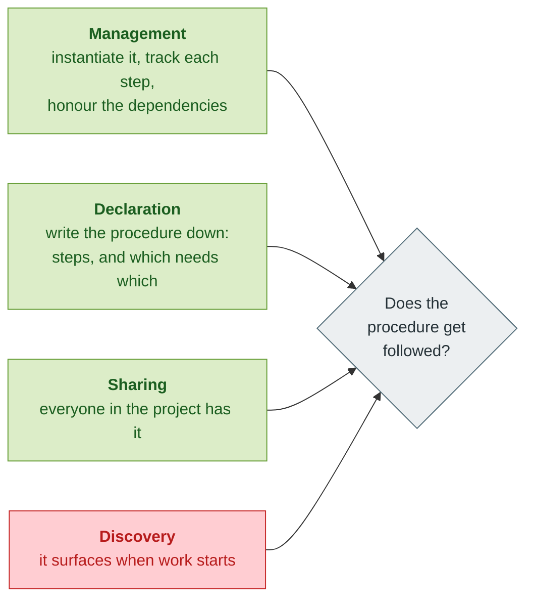
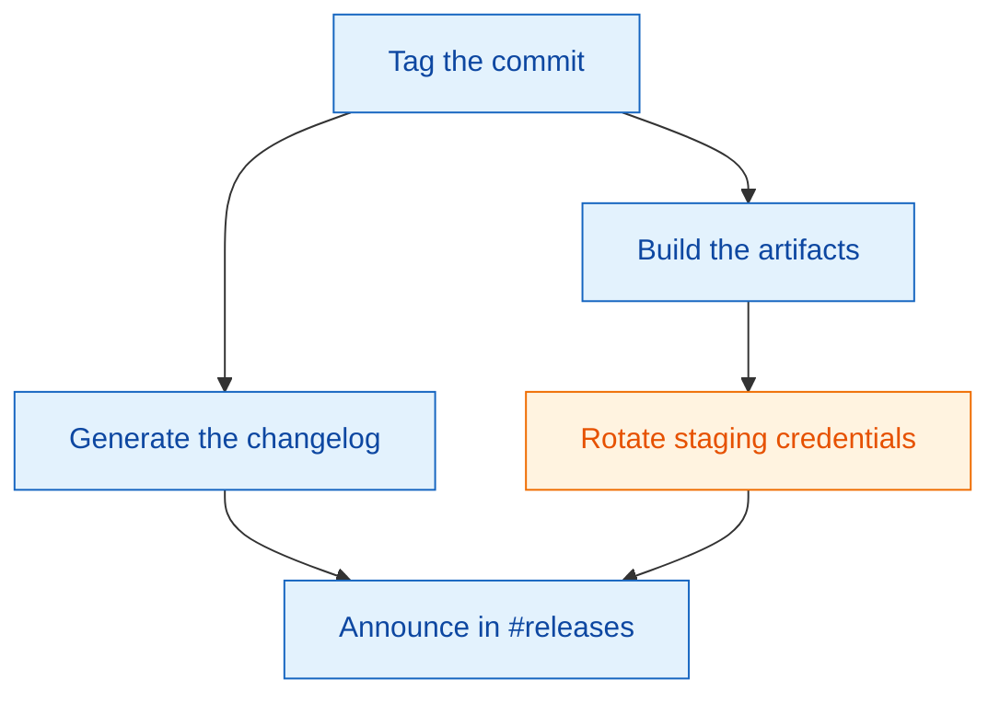
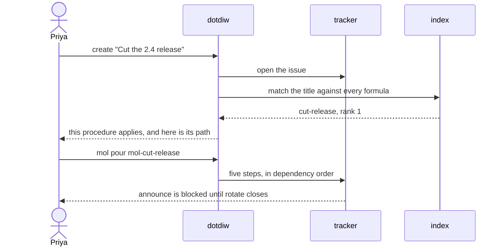
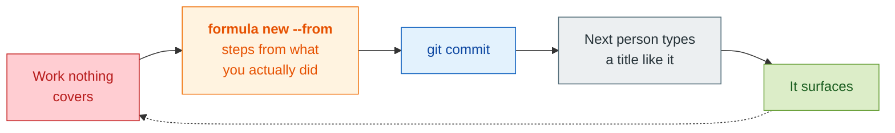

# dotdiw

**The procedure that applies to your work should find you. You should not have to
know it exists.**

---

## A Thursday

Priya cuts the 2.4 release. She tags the commit, builds the artifacts, generates
the changelog from the tag range, announces it in `#releases`. Good release.

She does not rotate the staging credentials.

That step exists. It is step four of a document written nineteen months ago by
someone who has since left, in `docs/release-process.md`, a file Priya has never
opened because she has never had a reason to know it is there. Nobody finds a
runbook by needing it. You find a runbook by already knowing its name.

Three weeks later an agent is asked to ship 2.5. It tags, builds, writes a
changelog, announces. It does not rotate the staging credentials either — same
file, same reason. On its way past it writes `docs/how-to-release.md`, so the
project now has two runbooks neither of which anyone will open.

**The procedure was never missing. It just never surfaced.**

---

## Four things have to work



Three of them you already have. An issue tracker that honours dependencies does
management and declaration. Git does sharing. **Discovery is the one nothing
provides** — and it is the one that decides whether the other three matter,
because a procedure nobody finds is a procedure nobody follows.

`dotdiw` adds discovery, and puts all four under one name so no task ever
requires typing anything else.

---

## The same Thursday, with dotdiw

### 1. Someone wrote the procedure down once

Not as prose. As a file that can be matched against a title and poured into
steps.

```toml
# services/billing/cut-release.formula.toml
formula = "mol-cut-release"
description = """Cut and publish a release: tag, build, changelog, rotate the
staging credentials, announce. Use when shipping a version to users."""
examples = [
  "Cut the 2.4 release",
  "Ship v3 to production",
  "Get billing out to prod this afternoon",
]

[[steps]]
id = "tag"
title = "Tag the commit"

[[steps]]
id = "build"
title = "Build the artifacts"
needs = ["tag"]

[[steps]]
id = "notes"
title = "Generate the changelog from the tag range"
needs = ["tag"]

[[steps]]
id = "rotate"
title = "Rotate the staging credentials"
needs = ["build"]

[[steps]]
id = "announce"
title = "Announce in #releases"
needs = ["notes", "rotate"]
```

It lives **next to the thing it is about** — `services/billing/`, not a folder of
its own. The path is matched too, so `services/billing/cut-release` already
answers to "billing" and "release" without the description repeating them.



The step Priya missed is the orange one. It is not buried in paragraph four of
anything. It is a node with an edge into `announce`, which means **the release
cannot be announced while it is open.**

### 2. Priya starts her work the way the project says to

```console
$ dotdiw create "Cut the 2.4 release"
✓ Created issue: mapleline-4k2 — Cut the 2.4 release

📜 Formulas that may apply:
  cut-release  Cut and publish a release: tag, build, changelog, rotate the s…
               services/billing/cut-release.formula.toml
  Run it: dotdiw mol pour mol-cut-release
```

She was not searching. She did not know the formula existed. She typed what she
was about to do, which she was going to type anyway.



### 3. She instantiates it

```console
$ dotdiw mol pour mol-cut-release
✓ Poured mol: created 6 issues
  Root issue: mapleline-mol-7qg
  Phase: liquid (persistent in the issue database)
```

Tracked, ordered, and durable — in git, not in anyone's head. When she tries to
close `announce` early:

```console
$ dotdiw close mapleline-mol-9f1
cannot close blocked issue: mapleline-mol-9f1 is blocked by [mapleline-mol-3dx]
```

**That is the whole mechanism.** The procedure found her because she named her
work, and the dependency she did not know about stopped her anyway.

---

## And when nothing matches?

That is the other half, and it is where procedures come from.

```console
$ dotdiw create "Handle the Stripe webhook backlog"
✓ Created issue: mapleline-8d1 — Handle the Stripe webhook backlog
```

Silence. No formula covers this. So you do the work — and the moment you notice
you have done something you will do again:

```console
$ dotdiw formula new "Handle the Stripe webhook backlog" --from mapleline-8d1
✓ Wrote handle-stripe-webhook-backlog.formula.toml
  Steps taken from mapleline-8d1, in the order the work was done.

  One thing left, and it is discoverable:
    the description   the situation, and when to reach for it

  Then:  git add handle-stripe-webhook-backlog.formula.toml && git commit
         dotdiw check
```

`--from` reads the issue's own children and the dependencies between them, and
writes them out as steps **in the order you actually did them**. The highest
fidelity capture there is: the procedure as carried out, not as remembered
afterwards.

Commit it, and the next person — or the next agent — has it. That is sharing;
there is nothing else to publish and nowhere else to put it.



---

## The two conventions

A project **states** these. They are not habits anyone holds — they bind whoever
shows up, human or agent, including everyone who was not there when they were
written. `dotdiw init` writes them into the files agents read.

### Work starts at one declared moment

Every task and subtask begins with `dotdiw create`. That declaration *is* the
mechanism, not a note about one: it is what gives discovery a hook that always
fires. Start by cutting a branch instead and nothing surfaces — the discipline
was skipped, not the mechanism broken.

### Procedures are described to be found

A description is the only thing standing between what someone calls their work
and the procedure that fits it. It names the situation and when to use it, in the
words people use for the work:

| | |
|---|---|
| **no** | `description = "Cut Release"` |
| **yes** | `description = "Cut and publish a release: tag, build, changelog, rotate the staging credentials, announce. Use when shipping a version to users."` |

The first is a label on a mechanism. The second **is** the mechanism.

### Both are checked, not hoped for

```console
$ dotdiw check
3 problems:
  services/billing/cut-release.formula.toml  description is 4 words -- write a sentence
                                             naming the situation, and when to use it
  docs/rotate-secrets.formula.toml           example "The Stripe key is in a public gist"
                                             does not retrieve it
  ops/incident.formula.toml                  not committed, so nobody else can see it
```

Each formula carries example titles, and `check` runs every one of them through
the ranker **with that example removed from the index first**. A formula its own
examples cannot retrieve is reported as undiscoverable — because it is. Leave the
example in and the test proves only that an indexed string can find itself.

`create` runs the same check quietly every time, so the moment that fires for
discovery is the moment that enforces.

---

## How it works

**Formulas are found with `git ls-files '*.formula.toml'`.** Anywhere in the
tree. The suffix is the convention, not the directory — nothing is registered,
nothing is copied into a config folder, and a formula you did not commit is
invisible. That is the sharing convention made mechanical rather than advisory.

**Retrieval is SQLite's FTS5**, which the interpreter already ships: bm25 ranking
and a porter stemmer, so a word is worth what it is distinctive and "failing"
reaches "fail". Nothing is installed and nothing is hand-rolled.

**The project's own prose is indexed alongside the formulas, and never
returned.** It is there so the ranker can tell which words are everyday ones
*here*. Against four documents, "version" looked distinctive enough to pull up
the release formula for a Go toolchain bump. Against twenty-two, it does not.

**Silence is a fraction, not a score.** A formula shows when it accounts for at
least 0.15 of what is distinctive about your title. A ratio rather than a
threshold, because bm25's scale depends on how much text a project has — an
absolute floor calibrated on a documented project silences every match in a
project with one formula and a two-line README, where bm25's idf is zero by
construction.

---

## What was measured, including what failed

`measurements/` holds the apparatus behind every number here: eleven domain
fixtures, four project states, scorers that read ground truth from an invocation
log and from git rather than from what an agent claimed, eleven retrieval sweeps,
and the scripts that ran forty-four blind agent runs.

**It changes behaviour, and only through the files agents read.** Across eleven
projects, agents given a job and told nothing about the tooling:

| | before | after |
|---|---|---|
| left formulas where they belonged | 0 of 5 | 11 of 11 |
| used `create` for the work | 2 of 5 | 11 of 11 |
| ran `check` | 0 of 5 | 11 of 11 |
| wrote a formula for uncovered work | 0 of 33 | 8 of 11 |
| committed the formula they wrote | 0 of 9 | 7 of 9 |

Every fix that moved those numbers landed in `AGENTS.md`. Every runtime nudge
changed nothing. **Declared and checkable works; reminding does not.**

**And the limit.** Pooled to 56 formulas, retrieval scales and silence does not:

| formulas | right formula in top 3 | titles nothing covers, left silent |
|---|---|---|
| 3 | 94% | 88% |
| 12 | 96% | 45% |
| 30 | 95% | 24% |
| 56 | 93% | **5%** |

At fifty-six formulas, titles describing work no formula covers retrieve
something anyway — and the hits are not bugs. A formula for draining a node
shares *replace* and *waiting* with "replace the waiting room chairs", because
draining a node means replacing it and waiting for connections to finish. Right
document by word overlap, wrong procedure for the work.

Raising the threshold costs about one real retrieval per coincidence suppressed.
Requiring two shared words is the same curve. A local embedding model gives the
first rule whose silence survives scale — 0.91 at fifty-six formulas — but only
at 0.55 recall instead of 0.93.

**So this holds at tens of procedures.** Telling "replace a chair" from "replace
a node" needs something that reads the title rather than counting its words.
Whether that is a limit of the design or only of the rules tried against it is
unresolved: a local model that *judges* rather than scores installs the same way
and has not been tested.

`IMPLEMENTATION.md` is specific about which claims have numbers behind them and
which do not.

---

## The promise, written down

dotdiw is described in the discipline it asks of a project, as files that
validate against the schemas they declare. Each is thin where it should be and
owns only what is its own.

- `product.yaml` -- the promise: what may be relied on, by whom, under what
  conditions and boundaries, with the evidence that it was kept and the ways
  it could look kept while broken.
- `praxis.yaml` -- the lived capability that keeps it: what whoever works here
  must notice, judge and do, what proves it, what would betray it, and the
  lawful lifecycles of a piece of work and of a formula.
- `carrier.yaml`, `reliant-enactments/` -- who may stand in the product's
  position, and one real occasion of reliance.
- `poa/product-model.yaml` and `operation-idl.json` -- the governed source and
  the operation algebra derived from it: twenty-five operations, each traced
  to a duty, a step and a lawful lifecycle transition. `poa/finish-idl.py`
  finishes every derivation from `poa/idl-additions.json` and
  `poa/idl-patches.json`: the real command-line bindings, the calls between
  operations, the beads and git calls that cross the boundary.
- `promise_bindings.py` -- every operation bound to its one body in `dotdiw`,
  under the IDL's name. `dotdiw` is shaped by it: one function per operation,
  nothing shared between them but infrastructure, and `main()` only routes.
  `test_promise.py` holds the file to that from its source alone.
- `contracts/`, `events/` -- the witness contract: which observed events are
  allowed to count as "work was named and its procedure surfaced", proved
  against this tool's own 0.2.1 release, a run recorded with the witness log
  on, and three anti-golden traces it must reject.

`check-promise-artifacts.formula.toml` is how they are re-derived and checked.

## Install

Once per machine, the way git is installed:

```bash
brew install adimpression/tap/dotdiw
```

That pulls `beads`, `git` and `python@3.12`. `dotdiw` is a single Python file
depending only on the standard library; putting it on `PATH` works just as well.
The Homebrew formula lives in
[Adimpression/homebrew-tap](https://github.com/Adimpression/homebrew-tap), not
in this repository.

### What `dotdiw init` changes in a repository

v0.1.0 said nothing is configured per project. That was wrong, and worth stating
plainly rather than quietly correcting. `init` calls `bd init`, and bd:

- created `.beads/`, its issue database, and committed its own files;
- set `core.hooksPath` to `<repo>/.beads/hooks`. bd copies the hooks that were
  already in `.git/hooks` into that directory and appends its own block, so
  hooks present at adoption keep running. **Hooks added to `.git/hooks`
  afterwards do not**: git reads one hook directory, and from then on it is
  bd's snapshot;
- configured a Dolt remote aimed at the repository's git remote, so the issue
  database was pushed into the repository, keeping its full history;
- left bd's telemetry enabled, which ships on by default.

From v0.2.0 `init` declines the hooks, removes the Dolt remote, and says what it
did. Any invocation in a repository adopted by v0.1.0 also puts both back and
prints what it undid. Nothing was deleted and no history was rewritten, and
hooks that existed at adoption went on running; a hook added after adoption was
skipped until the repair, so commits made in between did not see it.

From v0.2.1 every run also turns bd's anonymous usage metrics off before it
runs any bd command: `bd metrics off`, which writes `metrics.disabled: true`
to `~/.config/bd/config.yaml`. That is per machine, not per repository, and
it is the one thing dotdiw changes outside the repository. It says so the
first time, and does it again on every run, so `bd metrics on` does not hold.

From v0.3.0 `init` ran bd in its stealth mode, which commits nothing and
configures no remote, but still kept `.beads/` in the working tree. From
v0.4.0 the tracker's state leaves the repository altogether. `init` writes one
line into the checkout's own `.git/config`, `dotdiw.workspace`, a random key,
and runs `bd init --stealth --skip-hooks --skip-agents` under
`~/.dotdiw/<key>/`, telling bd where through `BEADS_DIR`. Every dotdiw command
does the same, so bd never sees the repository. What is left in the
repository is dotdiw's declaration of where work starts, in `CLAUDE.md` and
`AGENTS.md`, named as yours to commit; the command it prints leaves the tree
clean. The key survives a move, worktrees share it, and a fresh clone has
none, so every clone runs `dotdiw init` once and `create` says so until it
has. A plain `bd` typed in the repository finds no tracker; everything goes
through dotdiw, which is the point. A `BEADS_DIR` of your own is overridden
for the bd that dotdiw runs. Outside a git repository `init` refuses.

A repository adopted by an earlier version is upgraded by its first dotdiw
command: the key is written, a tracker is made under the home with the same
prefix, and the command runs. Earlier tasks are not carried over; dotdiw says
so once, and names the one command that removes the unused `.beads/` from the
tree. It never runs that command and never edits the old copy.

The one file dotdiw writes that is opt-in is the witness log,
`~/.dotdiw/<key>/witness.jsonl`. With `DOTDIW_WITNESS=1` set, or once that
file exists, every create, pour and close that goes through dotdiw appends one
JSON line -- the work id, the formula that surfaced or the silence, the
molecule and its steps -- and the contract in `contracts/` decides whether
those lines may be read as the promise kept. It is local, append-only, never
transmitted, and never in the repository. A step closed with `bd` directly
never reaches it, and the contract says so. Off, it writes nothing.

## Commands

```bash
dotdiw init                                  # adopt it: the tracker under your home, keyed to this checkout; the conventions declared
dotdiw create "<what you're about to do>"    # where all work starts
dotdiw formula new "<what it's for>"         # write a procedure down
dotdiw formula new "..." --from <id>         # ...with steps from work already done
dotdiw formula list                          # what this project holds
dotdiw mol pour <id>                         # instantiate it as tracked, ordered steps
dotdiw check                                 # whether every formula here can be found
dotdiw learn                                 # all of it, for whoever found the command
```

Everything else forwards to [beads](https://github.com/gastownhall/beads)
unchanged, so no task ever requires typing anything else.

## The name

Do one thing and do it well — *do it well* being the part a project keeps
forgetting, and the part a formula remembers for it.

## Licence

Apache 2.0. See [LICENSE](LICENSE).
