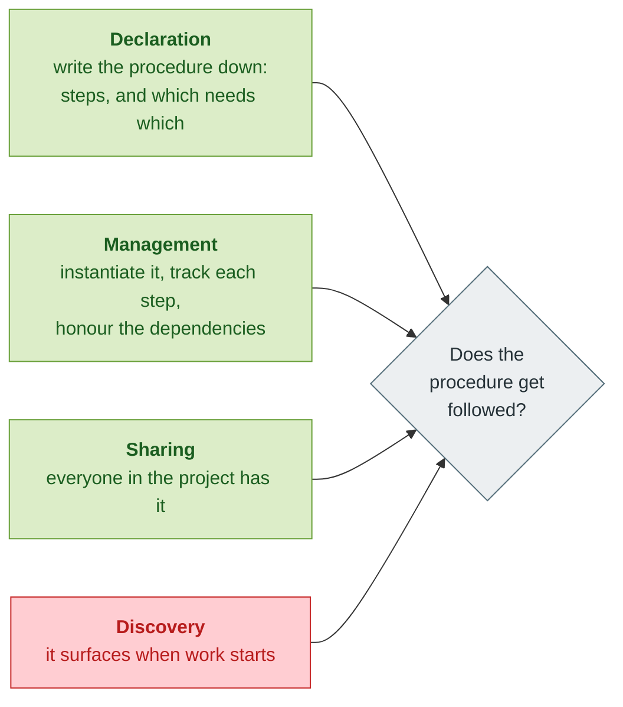
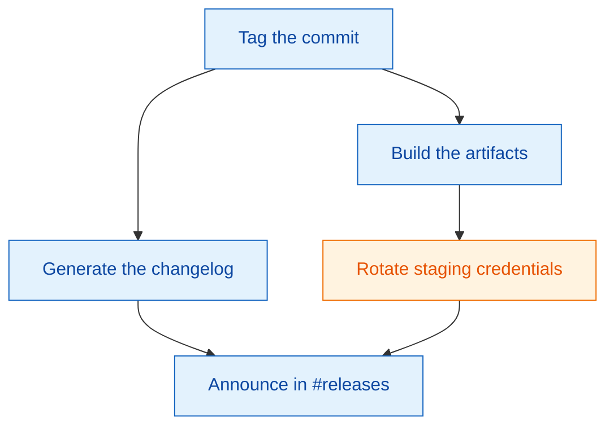
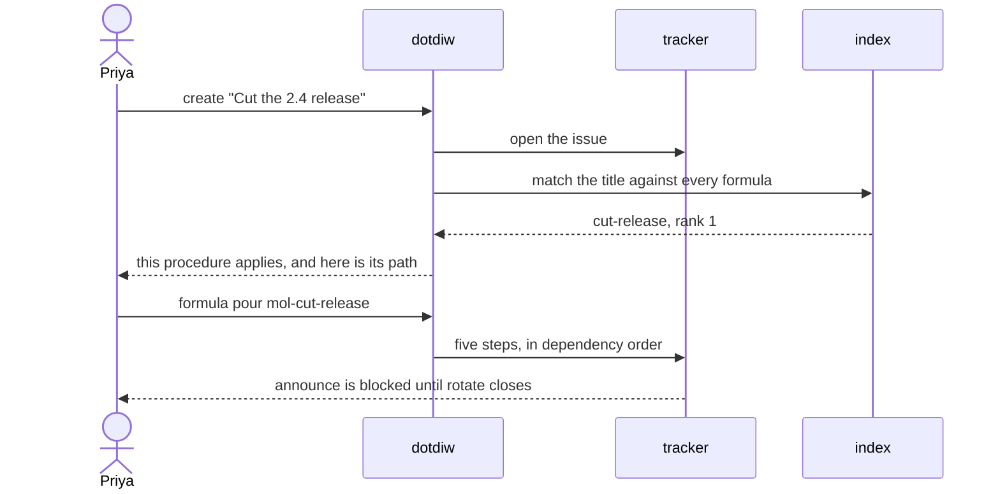
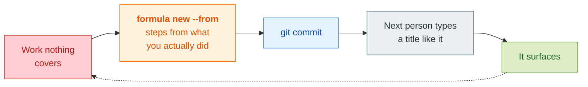

# dotdiw

**The procedure that applies to your work should find you. You should not have to
know it exists.**

---

## A Thursday

Priya cuts the 2.4 release. She tags the commit, builds the artifacts, generates
the changelog from the tag range, announces it in `#releases`. Good release.

She does not rotate the staging credentials.

That step exists. It is step four of a document written nineteen months ago by
someone who has since left, in `docs/release-process.md`, a file Priya has never
opened because she has never had a reason to know it is there. Nobody finds a
runbook by needing it. You find a runbook by already knowing its name.

Three weeks later an agent is asked to ship 2.5. It tags, builds, writes a
changelog, announces. It does not rotate the staging credentials either — same
file, same reason. On its way past it writes `docs/how-to-release.md`, so the
project now has two runbooks neither of which anyone will open.

**The procedure was never missing. It just never surfaced.**

---

## Four things have to work



Three of them are already solved. A file in the repository declares the
procedure, an issue tracker that honours dependencies manages it, and git shares
it. If you have no tracker, dotdiw brings one: a single file under your home
directory. If you already use one, an adapter lets dotdiw use it instead.

**Discovery is the one nothing provides**, and it decides whether the other three
matter: nobody follows a procedure they never find.

`dotdiw` adds discovery and puts the tracker behind one command, so no task ever
requires typing the tracker's own name.

---

## The same Thursday, with dotdiw

### 1. Someone wrote the procedure down once

Not as prose. As a file that can be matched against a title and poured into
steps.

```toml
# services/billing/cut-release.formula.toml
formula = "mol-cut-release"
description = """Cut and publish a release: tag, build, changelog, rotate the
staging credentials, announce. Use when shipping a version to users."""
examples = [
  "Cut the 2.4 release",
  "Ship v3 to production",
  "Get billing out to prod this afternoon",
]
verify-using = [
  "run:git describe --tags --exact-match",
  "git+https://git.example.invalid/mapleline/billing.git#services/billing/CHANGELOG.md",
  "https://chat.example.invalid/mapleline/releases",
]

[[steps]]
id = "tag"
title = "Tag the commit"

[[steps]]
id = "build"
title = "Build the artifacts"
needs = ["tag"]

[[steps]]
id = "notes"
title = "Generate the changelog from the tag range"
needs = ["tag"]

[[steps]]
id = "rotate"
title = "Rotate the staging credentials"
needs = ["build"]

[[steps]]
id = "announce"
title = "Announce in #releases"
needs = ["notes", "rotate"]
```

It lives **next to the thing it is about** — `services/billing/`, not a folder of
its own. The path is matched too, so `services/billing/cut-release` already
answers to "billing" and "release" without the description repeating them.



The step Priya missed is the orange one. It is not buried in paragraph four of
anything. It is a node with an edge into `announce`, which means **the release
cannot be announced while it is open.**

`verify-using` names the means to prove that the run did what the formula
claims, one to a line: a command after `run:`, a file in a repository as a
`git+https://` or `git+ssh://` URL with its path after `#`, or a link. dotdiw
shows them when the formula is poured, the tracker keeps them on the root, and
`dotdiw check` names any it cannot read, any longer than a line, and a file of
this repository that git does not track. Before the root closes, whoever ran
the release proves it with them: runs the command, reads the file, opens the
link.

A step can also declare a claim: what whoever does it can assert once it is
done, in the formula's own terms. The claim is a `statement` with a
`{{ label }}` placeholder for each slot, and each slot is declared by its label
in lowercase kebab-case followed by a colon:

```toml
[steps.claim]
statement = "Tagged {{ name }} at commit {{ commit }}."
"name:" = {}
"commit:" = {}
```

The pour names each claimed step and the command that records it.
`dotdiw claim <id> 'name: v2.4.0' 'commit: 9f3c2ab'` records the values on that
step, from its arguments or, given none, from standard input, and prints the
run, from the steps its pour made and no other, wherever each stands now, read
from any of them or its root: each claim filled from its own
values, and `verify-using` filled from them, where `{{ tag.name }}` reads the
`tag` step's `name`, split at the last dot. A value fills `verify-using` only
when it is simple -- letters, digits and `. _ : / @ + -` -- and a placeholder
with no value stays as written and is named open; `--json` prints the run as
data. Under the beads tracker the values go on the step's own issue in one
write. bd reads an id it no longer holds as the one issue whose id begins with
it, so a step deleted as that write runs may have its values written to that
issue instead, and the command then fails naming it. A claim the formula cannot
declare well is named by `dotdiw check`, and so
is a `verify-using` placeholder that names no claimed slot; a file of this
repository that a slot names is left to the run, which records it. A root stays
open while a step poured in its run is open, wherever that step stands, and
closes with the last of them; `dotdiw update --parent` and `dotdiw dep add`
refuse to make a root wait on a step that waits on it.

A step may call another formula instead of repeating its steps -- a procedure
another team keeps, named as `dotdiw formula pour` names one, a provider's
included:

```toml
[[steps]]
id = "clear-image-rights"
title = "Clear the selected image for paid social"
formula = "clear-image-for-paid-social"

[[steps]]
id = "prepare-publication"
title = "Prepare the campaign for publication"
needs = ["clear-image-rights"]
```

The pour pours the steps of `clear-image-for-paid-social` within
`clear-image-rights`, in the same run: the whole job is one run under one
root. The call's steps wait on what `clear-image-rights` needs -- or, where it
needs nothing, on what the step it stands within needs, to any depth -- and
`clear-image-rights` needs every one of them -- a need no update takes off
-- and closes itself, through dotdiw, once they and its own needs are done,
whichever is last, which can close what it stands within in turn, up to the
root; `prepare-publication` waits on all of it. Each call is an
instance of its own, named by the calling step's item, which every item
poured within it carries as `within`, set when it is made and kept wherever
the item is moved: two steps that call one formula pour it twice, and each
call keeps its own claims and `verify-using`, which `dotdiw claim` reads back
call by call. A calling step may name needs and declares no claim; a step
after it claims what the call found.

Every call, and every call those formulas make, is resolved before anything
is written, and what was resolved is what is poured, whatever is written to
a formula meanwhile: a reference that names no formula or more than one,
calls that go round, a called formula whose steps share an id, need a step
that is none of them or wait on each other, and a calling step that declares
a claim are refused, naming the step and the reference, and nothing is
poured. So is a pour that calls a formula into a tracker that does not say
it pours calls; the local tracker, beads and Jira do. The local tracker
writes the whole job in one transaction. beads and Jira write it one item at
a time, so they hold it on a guard -- an item of its own, `Pour of
<formula>`, made first, outside the root's children, and closed last, once
the root is marked whole, and written by nothing else: until then neither
the root nor any calling step can complete, nothing of the pour is given
ready and no move carries it, whatever a write outside dotdiw does to the
guard, so a pour cut short leaves nothing that finishes as if whole, and
names the guard and the way out. Once its guard has closed, a root marked
whole holds nothing, so housekeeping that deletes a closed guard frees its
run. `dotdiw check` names a calling step with a claim, and a
`formula` that is not text. A step id is only ever an id: one with a slash
in it means what it always meant.

### 2. Priya starts her work the way the project says to

```console
$ dotdiw create "Cut the 2.4 release"
✓ Created issue: mapleline-4k2m — Cut the 2.4 release

📜 Formulas that may apply:
  cut-release  Cut and publish a release: tag, build, changelog, rotate the s…
               services/billing/cut-release.formula.toml
  Run it: dotdiw formula pour mol-cut-release
```

She was not searching. She did not know the formula existed. She typed what she
was about to do, which she was going to type anyway.



### 3. She instantiates it

```console
$ dotdiw formula pour mol-cut-release
✓ Poured mol: created 6 issues
  Root issue: mapleline-7qgd
Verify using:
  run:git describe --tags --exact-match
  git+https://git.example.invalid/mapleline/billing.git#services/billing/CHANGELOG.md
  https://chat.example.invalid/mapleline/releases
```

Tracked, ordered and durable, in the tracker and not in anyone's head. When she
tries to close `announce` early:

```console
$ dotdiw close mapleline-9f1x
cannot close blocked issue: mapleline-9f1x is blocked by [mapleline-3dxa]
```

**That is the whole mechanism.** The procedure found her because she named her
work, and the dependency she did not know about stopped her anyway.

---

## And when nothing matches?

That is the other half, and it is where procedures come from.

```console
$ dotdiw create "Handle the Stripe webhook backlog"
✓ Created issue: mapleline-8d1k — Handle the Stripe webhook backlog
```

Silence. No formula covers this. So you do the work — and the moment you notice
you have done something you will do again:

```console
$ dotdiw formula new "Handle the Stripe webhook backlog" --from mapleline-8d1k
✓ Wrote handle-stripe-webhook-backlog.formula.toml
  Steps taken from mapleline-8d1k, in the order the work was done.

  One thing left, and it is discoverable:
    the description   the situation, and when to reach for it

  Then:  git add handle-stripe-webhook-backlog.formula.toml && git commit
         dotdiw check
```

`--from` reads the issue's own children and the dependencies between them, and
writes them out as steps **in the order you actually did them**. The highest
fidelity capture there is: the procedure as carried out, not as remembered
afterwards.

Commit it, and the next person — or the next agent — has it. That is sharing;
there is nothing else to publish and nowhere else to put it.



---

## The two conventions

A project **states** these. They are not habits anyone holds — they bind whoever
shows up, human or agent, including everyone who was not there when they were
written. `dotdiw init` writes them into the files agents read.

### Work starts at one declared moment

Every task and subtask begins with `dotdiw create`. That declaration *is* the
mechanism, not a note about one: it is what gives discovery a hook that always
fires. Start by cutting a branch instead and nothing surfaces — the discipline
was skipped, not the mechanism broken.

### Procedures are described to be found

A description is the only thing standing between what someone calls their work
and the procedure that fits it. It names the situation and when to use it, in the
words people use for the work:

| | |
|---|---|
| **no** | `description = "Cut Release"` |
| **yes** | `description = "Cut and publish a release: tag, build, changelog, rotate the staging credentials, announce. Use when shipping a version to users."` |

The first is a label on a mechanism. The second **is** the mechanism.

### Both are checked, not hoped for

```console
$ dotdiw check
3 problems:
  services/billing/cut-release.formula.toml  description is 4 words -- write a sentence
                                             naming the situation, and when to use it
  docs/rotate-secrets.formula.toml           example "The Stripe key is in a public gist"
                                             does not retrieve it
  ops/incident.formula.toml                  not committed, so nobody else can see it
```

Each formula carries example titles, and `check` runs every one of them through
the ranker **with that example removed from the index first**. A formula its own
examples cannot retrieve is reported as undiscoverable — because it is. Leave the
example in and the test proves only that an indexed string can find itself. A
formula file that does not parse is named too, since nothing can find it, and a
formula HEAD does not hold is named as one nobody else can see.

`create` runs the same check quietly every time, so the moment that fires for
discovery is the moment that enforces.

---

## How it works

**Formulas are found on the file system.** Anywhere in the tree, every
directory whose name starts with a dot left out. The suffix is the convention,
not the directory — nothing is registered, nothing is copied into a config
folder. A formula you did not commit is found in your checkout alone, and
`dotdiw check` names it as one nobody else can see.

**Formulas kept elsewhere come through a provider**, registered once under a
name that every one of its formulas then carries as a suffix. Each provider's
list is read once per run, and its formulas are matched and listed from it as
the ones in the tree are; a formula itself is fetched from the provider, as
data, only when it is shown or poured, and nothing is written for it.

**Retrieval is SQLite's FTS5**, which the interpreter already ships: bm25 ranking
and a porter stemmer, so a word is worth what it is distinctive and "failing"
reaches "fail". Nothing is installed and nothing is hand-rolled.

**The project's own prose is indexed alongside the formulas, and never
returned.** It is there so the ranker can tell which words are everyday ones
*here*. Against four documents, "version" looked distinctive enough to pull up
the release formula for a Go toolchain bump. Against twenty-two, it does not.

**Silence is a fraction, not a score.** A formula shows when it accounts for at
least 0.15 of what is distinctive about your title. A ratio rather than a
threshold, because bm25's scale depends on how much text a project has — an
absolute floor calibrated on a documented project silences every match in a
project with one formula and a two-line README, where bm25's idf is zero by
construction.

---

## What was measured, including what failed

`measurements/` holds the apparatus behind every number here: eleven domain
fixtures, four project states, scorers that read ground truth from an invocation
log and from git rather than from what an agent claimed, eleven retrieval sweeps,
and the scripts that ran forty-four blind agent runs.

**It changes behaviour, and only through the files agents read.** Across eleven
projects, agents given a job and told nothing about the tooling:

| | before | after |
|---|---|---|
| left formulas where they belonged | 0 of 5 | 11 of 11 |
| used `create` for the work | 2 of 5 | 11 of 11 |
| ran `check` | 0 of 5 | 11 of 11 |
| wrote a formula for uncovered work | 0 of 33 | 8 of 11 |
| committed the formula they wrote | 0 of 9 | 7 of 9 |

Every fix that moved those numbers landed in `AGENTS.md`. Every runtime nudge
changed nothing. **Declared and checkable works; reminding does not.**

**And the limit.** Pooled to 56 formulas, retrieval scales and silence does not:

| formulas | right formula in top 3 | titles nothing covers, left silent |
|---|---|---|
| 3 | 94% | 88% |
| 12 | 96% | 45% |
| 30 | 95% | 24% |
| 56 | 93% | **5%** |

At fifty-six formulas, titles describing work no formula covers retrieve
something anyway — and the hits are not bugs. A formula for draining a node
shares *replace* and *waiting* with "replace the waiting room chairs", because
draining a node means replacing it and waiting for connections to finish. Right
document by word overlap, wrong procedure for the work.

Raising the threshold costs about one real retrieval per coincidence suppressed.
Requiring two shared words is the same curve. A local embedding model gives the
first rule whose silence survives scale — 0.91 at fifty-six formulas — but only
at 0.55 recall instead of 0.93.

**So this holds at tens of procedures.** Telling "replace a chair" from "replace
a node" needs something that reads the title rather than counting its words.
Whether that is a limit of the design or only of the rules tried against it is
unresolved: a local model that *judges* rather than scores installs the same way
and has not been tested.

`measurements/README.md` is specific about which claims have numbers behind
them and which do not.

---

## The promise, written down

dotdiw is described in the discipline it asks of a project, as files that
validate against the schemas they declare. Each is thin where it should be and
owns only what is its own.

- `product.yaml` -- the promise: what may be relied on, by whom, under what
  conditions and boundaries, with the evidence that it was kept and the ways
  it could look kept while broken.
- `praxis.yaml` -- the lived capability that keeps it: what whoever works here
  must notice, judge and do, what proves it, what would betray it, and the
  lawful lifecycles of a piece of work and of a formula.
- `carrier.yaml`, `reliant-enactments/` -- who may stand in the product's
  position, and one real occasion of reliance.
- `poa/product-model.yaml` and `operation-idl.json` -- the governed source and
  the operation algebra derived from it: fifty-five operations, each traced
  to its source duty, journey or step, with changes bound to lawful lifecycle
  transitions; eleven operations form the
  tracker interface an adapter answers. Its gRPC projection is what
  `dotdiw serve` serves, and `test_promise.py` holds the descriptor served
  to the proto POA generates, field for field, and to
  `poa/grpc-fields-released.json`, which records each field the last
  release served by its number. `poa/grpc-field-number-registry.json` supplies
  those released numbers to POA; removed numbers remain reserved. Native
  `operationContracts` and `operationContractTypes` declare the fields, types,
  calls, classification and dependencies, while the source steps and journeys
  declare their actual participation. `poa derive` supplies those semantics
  without a completion patch. `poa/generate-project.py` attaches the separately
  governed CLI, implementation and witness manifests, projection descriptions
  and change records, and refuses to change the native operation definitions,
  types, call graph or any other section outside those attachments. It writes
  both doors, the adapter starter and the Python record types into `dotdiw`.
  The released `ForwardToTheTrackerResponse.answers` wire field remains repeated
  JSON strings through POA's explicit `--json-list-map` selection; its canonical
  IDL remains a list of maps. The generated metadata describes the encoding;
  the server and clients perform the encoding and decoding.
- `promise_bindings.py` -- every operation bound to its one body in `dotdiw`,
  under the IDL's name, and asked of the door as a command asks it, and each
  operation of the tracker interface to the adapter that answers it. `dotdiw`
  is shaped by it: one function per
  operation, nothing shared between them but infrastructure, every operation
  invoked through one door generated from the IDL, which holds the request
  and the response to their types; the tracker behind a second door of the
  same making, where an adapter answers in records and nothing but an
  adapter runs a tracker; and `main()` only routes. `test_promise.py` holds
  the file to that from its source alone, both doors and the types
  regenerated and compared; `test_tracker.py` runs the one scenario that defines an adapter
  against every adapter present.
- `contracts/`, `events/` -- the witness contract: which observed events are
  allowed to count as "work was named and its procedure surfaced", proved
  against this tool's own 0.2.1 release, a run recorded with the witness log
  on, and six anti-golden traces it must reject, three of them a molecule's
  close the log cannot vouch for: one that claims every step closed with none
  in the log, one before every step closed, and one from an older log, which
  does not say.

`check-promise-artifacts.formula.toml` is how they are re-derived and checked.

## Install

Once per machine, the way git is installed:

```bash
brew install adimpression/tap/dotdiw
```

The formula installs dotdiw and everything it needs to run. `dotdiw` itself is a
single Python file that needs only the standard library, Python 3.11 or later,
and it brings its own store for the work, so copied onto your `PATH` it works
just as well. To use another tracker instead of that store, install it
separately and choose it by name.
The Homebrew formula lives in
[Adimpression/homebrew-tap](https://github.com/Adimpression/homebrew-tap), not
in this repository.

### What `dotdiw init` does

`init` writes two lines of its own into the checkout's `.git/config`:
`dotdiw.workspace`, a random key, and `dotdiw.tracker`, the tracker this
checkout uses, `local` unless `init --tracker <name>` chose another. The
tracker's state lives under `~/.dotdiw/<key>/`: one sqlite file for the
store dotdiw brings, or whatever the chosen tracker keeps there. Every dotdiw
command finds it there, so nothing of the tracker's is in the repository: no
files, no hooks, no remote, no commit. What is left in the repository is
dotdiw's declaration of where work starts, in `CLAUDE.md` and `AGENTS.md`,
named as yours to commit; the command it prints leaves the tree clean. The
key survives a move and worktrees share it. A fresh clone has none, so every
clone runs `dotdiw init` once, and `create` says so until it has. Outside a
git repository `init` refuses.

A repository an earlier version adopted is brought up to date by `dotdiw
init`, and every other command but `learn` and `--version` says so in one line
until it has. init unsets bd's hooks path, makes a tracker under the home with
the same prefix for one kept in the tree, writes `dotdiw.tracker` for a
checkout adopted before there was a choice, and has the tracker bring a store
an earlier version kept up to date. Earlier tasks in the tree are not carried
over; dotdiw says so once, and names the one command that removes the unused
`.beads/` from the tree. It never runs that command and never edits the old
copy. When any of it cannot be done, init stops in one line and adopts
nothing.

The one file dotdiw writes that is opt-in is the witness log,
`~/.dotdiw/<key>/witness.jsonl`. With `DOTDIW_WITNESS=1` set, or once that
file exists, every create, pour and close that goes through dotdiw appends one
JSON line -- the work id, the formula that surfaced or the silence, the
molecule and its steps -- and the contract in `contracts/` decides whether
those lines may be read as the promise kept. It is local, append-only, never
transmitted, and never in the repository. A step closed outside dotdiw never
reaches it, and the contract says so. Off, it writes nothing.

## Choosing a tracker

Nothing changes unless you choose one. A new adoption uses `local`, the store
dotdiw brings: one sqlite file under `~/.dotdiw/<key>/`, nothing to install
and nothing running. `dotdiw tracker list` names what is registered and which
this checkout uses. `init --tracker <name>` chooses at adoption and `dotdiw
tracker use <name>` afterwards, leaving the work in the old one where it is;
`dotdiw tracker migrate <from> <to>` moves it, parents and each run's root
before what stands under them or was poured in them, needs, close reasons,
descriptions, the means to prove a run, and each step's claim, values and run
with them, ids kept
where the target accepts them and mapped in a file under the workspace where it
does not, and never writes to the source. If the target refuses any write the move fails and names it, and the
next run finishes what the first left. One command can go elsewhere with `--tracker <name>` or
`DOTDIW_TRACKER`. A tracker's name appears where you chose or asked for it: in
the `tracker` commands, on the line that says a checkout is adopted, on the
tracker line of `--version`, in a line saying what is wrong with the one a
checkout chose or with a name you gave, and once, in the notice that a checkout
adopted before there was a choice has been kept on the tracker its work is in.
Nothing else dotdiw says names one.

`beads` is the tracker every version before 0.6.0 ran on, kept as an adapter
so that a checkout adopted earlier goes on as it was: the commands of a day's
work print the same bytes. It needs its own binary, installed with
`brew install beads`. A checkout on beads without the binary is told that command
in one line. Under beads every command dotdiw does not own
runs in the tracker unchanged, interactive prompts included, and `dotdiw
--help` lists them, save those whose closes or waits dotdiw cannot check
against a run's steps before they run -- a batch, raw SQL, an import, a
duplicate, a delete, and the like -- which it refuses by name; a command it
checks is read as the tracker reads it, and a close counts as dotdiw's only
where the tracker kept dotdiw's mark on it. The tracker reads each id again
as it runs, so an item deleted between dotdiw's check and the tracker's write
may have that write land on the item whose id begins with its id, such as its
only step; dotdiw names that item where it can, and writes held to the item
checked wait for a later release; the tracker records its role beside the key, maintainer,
the answer it would otherwise ask for; a `BEADS_DIR` of your own is
overridden for the tracker dotdiw runs; and any run that reaches the tracker,
chosen or not, turns its anonymous usage metrics off before asking it anything,
`metrics.disabled: true` in `~/.config/bd/config.yaml`, per machine, the one
thing dotdiw changes outside `~/.dotdiw`, said the first time. The store dotdiw brings has no
metrics and no commands beyond the tracker's own, `list`, `ready`, `show`,
`close`, `update`, `dep add` and `dep remove`; `--help` prints what bare `dotdiw` prints,
and anything else it refuses by name.

A tracker not built into dotdiw is one file, `<name>.py`, exposing a table,
`TRACKER`, that holds the eleven operations of the interface as callables.
`dotdiw tracker new <name>` writes the file to start from. dotdiw finds it in
`~/.dotdiw/trackers/`, or in `share/dotdiw/trackers/` beside the `bin/` it runs
from, where a package named `dotdiw-tracker-<name>` installs it.
`dotdiw tracker check <name>`, or `dotdiw tracker check ./<name>.py` before it is
installed, runs the scenario that defines an adapter, in a scratch workspace or
against the project or board the module declares for it, and says what fails. A
file written for another interface is refused in one line that names it.

`dotdiw update <id> -a me` assigns an item to whoever the tracker knows you as. Any
other value goes to the tracker as its own id for a person, and a tracker that
checks refuses one it does not know; dotdiw never searches for a person by name.
`show` says who an item is assigned to. `tracker migrate` says how many items had
an assignee, because assignees do not carry over: an id in one tracker means
nothing in another.

`trackers/jira.py` in this repository is an adapter for Jira Cloud. To install it,
name both packages, because Homebrew loads a dependency from a tap only if that
formula is trusted, and naming a formula in `brew install` trusts it:

```bash
brew install adimpression/tap/dotdiw adimpression/tap/dotdiw-tracker-jira
```

The adapter reads its credentials from the environment or from
`~/.dotdiw/trackers/jira.json`, never from a repository. `init` names the
account they belong to, once, before any work is written as that person, and
`tracker use jira` names it each time. It is tested against a stub of the API in
`test_jira.py` and against nothing live.

## Formula management providers

Nothing changes unless you register one. The formulas in a checkout are in
local storage, the file system, found wherever they sit in the tree. A formula
management provider keeps its formulas in its own store, on a file system or
behind an API endpoint, and serves every checkout once you register it under a
name of letters and digits; `--at` names its store:

```bash
dotdiw formula provider register acme directory --at ~/shared/formulas
```

Every formula it serves carries that name as a suffix after a hyphen.
`mol-cut-release` in that directory is `mol-cut-release-acme` everywhere dotdiw
shows or takes an id: in `formula list`, which says it comes from the acme
provider, in `formula show`, in what `create` surfaces, and in `formula pour`,
which pours it as it pours a formula in the checkout. An id names its formula
first, then a path exactly as given, then a file's name, and two formulas that
answer at the same step are refused; an id with a provider's suffix answers to
that provider alone, and a local formula that declares one is reached only by
its path, with `dotdiw check` saying to rename it. `dotdiw
formula provider list` names what is registered and what each answers, and a
registration that cannot answer, with why. `dotdiw formula provider remove
<name>` takes a registration away; from then on an id with its suffix is
refused, never handed to the tracker, which may still hold a copy.

Registering refuses, in one line, a name already taken in any case, a name
that is not letters and digits, a module that is not installed, a module that
does not answer list and show, and a store that is not there. A directory is
recorded by its absolute path, so it names one store from every directory you
run dotdiw in. While the checkout holds a formula whose id ends in a hyphen and
that name, registering refuses and names the file, so that one id never names
two formulas; `dotdiw check` names such a formula in any checkout afterwards. A
provider's ids are letters, digits, dots, hyphens and underscores. A provider
that fails, or answers outside that shape, is left out of the run whole, with
one line naming it, and the formulas in the checkout surface as before.

dotdiw records each registration under your home, in
`~/.dotdiw/formula-providers.json`, one change at a time; the formulas stay in
the provider's store. `directory`, a directory of formula files outside any
checkout, ships inside dotdiw. Any other provider is one Python file, `<module>.py`, in
`~/.dotdiw/formula-providers/` or in `share/dotdiw/formula-providers/` beside
the `bin/` dotdiw runs from, where a package named
`dotdiw-formula-provider-<module>` installs it.
[`formula-providers/README.md`](formula-providers/README.md) says how to write
one.

## Other clients, over gRPC

Anything that is not a terminal -- a service, an agent platform, another
tool -- reaches the same operations over gRPC:

```bash
dotdiw serve                          # on 127.0.0.1:50051
dotdiw serve --address 127.0.0.1:0    # on any free port; the line it prints names it
```

The service is POA's projection of `operation-idl.json`,
`workflow.discovery.dotdiw.v0.DotdiwOperations`: one method for every
operation with a body that is not internal-only. A client is generated from
the proto `poa generate grpc` writes. `serve` needs grpcio and protobuf;
nothing else in dotdiw does.

Clients call at once, and one may change an item between another's read and
its write. So every item a read answers carries an ETag, a digest of the item
as the tracker holds it, the same through `show`, `list` and `ready`; and a
run read back carries one over every item poured in it. A write gives back,
in `etags`, the ETags it rests on, and takes effect only if each still
matches. Otherwise nothing is written and the call fails with `ABORTED`, as
AIP-154 has it, and the client reads again and decides again. The compare and
the write are one step, under the lock of the store the write goes to: a
checkout's workspace holds the store of the local tracker and of beads, so
the lock is the workspace's; a tracker loaded from a file may keep its store
where other checkouts reach it -- every checkout adopted on one Jira project
does -- so its lock is one that every checkout under the same dotdiw home
(`~/.dotdiw`) shares, the home being where the tracker's name means that
adapter. Each request finds the checkout's tracker afresh -- its choice, or,
where it has made none, the one tracker holding a store in its workspace --
and keeps it for its length: a write's lock, its compare, its write and what
it reads back all go to one tracker, even if the checkout switches meanwhile
or a move makes another store, and a running `dotdiw serve` follows a switch
made on the command line from its next request. Nothing
is held between two calls, so a client that fails between them leaves
nothing behind. A write given no ETags is unconditional, as on the command
line, though a create under a parent and a pour still take the lock, as a
close does, and under beads so do `q` and `reopen` passed through, so that
a close cannot find nothing open under an item while work is being made or
reopened under it. `init` brings a store an earlier version made
up to date under the lock too, since that rewrites items, and their ETags
with them. One move of a workspace runs at a time, so two at once make nothing
twice; it reads the source whole under the source's lock, letting go of it
before it writes, so it never reads a pour half made, its steps without their
needs; and it writes the target under the target's lock from its first write
there to its last, as a pour does, so a step it made is never closed before
it waits on what it needs. A move that stops part way leaves what it made
unfinished -- an item the target made and could not read back included, which
the next run finishes rather than make again -- and until the move runs again,
in the checkout it ran in, and finishes it, nothing closes any of that through
dotdiw or lists it as ready, `dotdiw ready` under beads included, and no move
from that tracker runs, since it would read that half made -- from this
checkout, or, under a tracker loaded from a file, from any checkout under the
home on the same store; another Jira site's project of the same key is no part
of it, nor is another project, whose checkouts reach none of this one's issues.
An item the move made and has not finished that the target then says it
holds none of stays made too, since Jira says so of an issue its caller
cannot see: the next run writes nothing more until it can be read, or until
`dotdiw tracker migrate <from> <to> --deleted <id>` says it was deleted,
which makes it again, finished or not; what waited on it or stood under it
is written again to the new one, and only what the move made in its run
must be deleted and named too, which the run says. Nothing but the move
closes what it has not finished, by name or in the wake of another close: a
root left with nothing open by the close of its last step stays open while
the move holds it. What the move does not
close is finished, and held by nothing, once its needs and status are
written, so a close the target refuses -- Jira will not close an issue whose
need is open, nor local one whose child is -- holds only what is to be
closed, and closing what it waits on there lets the next run through. A
move takes each item it writes of as the source shows it by its id, and
reads by id what its listing lacks: while the source shows what it does not
list, as Jira does for a while after a write, the run writes nothing; what
it made of an item the source neither lists nor shows stays held; and
`--source-gone <id>` says the source holds an item no more -- deleted, or
archived, which Jira shows and lists no more -- which leaves the copy made
of it as made; a need on it or a place under it is written to that copy,
or, where the move made none, left out, and said. A need or parent
the source shows none of, as a Jira issue's in another project, is left out
too, the move saying which, as is the root of a run. Every command a
refusal gives names all the run was told, its stores included. While a move
stands stopped the source may change: the next run brings each item it made
and has not finished in line with what the source shows now -- a need it
wrote and a parent the source no longer shows taken off first, so that
nothing written after makes a cycle; then title, priority, parent, a claim's
values in the source's order, each need the copy lacks, and a status set back
to open; a copy closed already stays closed, keeping its close reason -- a
close cut short is finished with the source's -- and says what only a make
writes and it kept as made, a close reason it kept, and what the target holds
that the source does not, as a need written there on a copy the move holds,
which it keeps. Where the target refuses a write as a cycle that a need it
keeps closes, the run names that need: `dotdiw dep remove <id> <need>` takes
one off. The run that finishes the move says what every run since it last
finished left out, kept or forgot, as the copies then stand. An item gone from
the source whose copy is deleted in the target too, told both ways, is
forgotten. The move's own closes leave open what it has yet to close, so a
run's root keeps its own close reason. A run whose
target
names another store than the move wrote to -- `JIRA_SITE` changed, say --
writes nothing there, and neither does one whose source names another store
than the move read from, since that store's issues of the same keys are
other issues. A record written by an earlier dotdiw names no store: a run of
it writes nothing until `--from-store <store>` or `--to-store <store>` names
the store the move read from or wrote to, as the run's answer gives it. Under
Jira an issue is made under a parent, or in a run, of its own project alone,
and an issue's open children and needs in another project, where a site puts
them, hold its close; and since Jira's search is without a write for a while
after it, what was written through this dotdiw home in the last ten minutes
is read by key wherever a close looks for open children or steps, a cycle
check for what an issue waits on, or a listing, `ready` or `show` for every
issue, so a step closed right after its pour leaves its root open and a need
added a moment ago keeps its issue out of `ready`; a child the search still
has open that Jira will not show by its key holds its parent's close.
`ready` reads under the store's lock, so it lists nothing a pour or a move
is part way through, and waits for one as a close does; so
does bd's own `ready` under beads. One adoption of
a checkout runs at a time
too, whether git was told the checkout's directory through `GIT_DIR` or not,
and reads the checkout's key and choice again once it runs, so two `init`s
at once leave the checkout one workspace, and a `tracker use` made while
`init` looks is not undone. A move opens its target under the same lock, so
a move to Jira and an `init` naming another project at once leave the
checkout on one project. Raced on one item by
sixteen clients, 480 writes lost none with ETags; without them, 452 were lost.

Without a terminal, `list`, `ready` and `show` answer records under every
adapter, beads included, and a command the tracker runs itself answers with
its output.

What stays outside: a write made past dotdiw -- bd itself, Jira's own screens,
or a bd command dotdiw passes through as it is, given no ETags -- can land
between the compare and the write, and so can one made through dotdiw under
another home or on another machine, since two homes writing one hosted
project share no lock and Jira offers no write held to a version. `serve` has no TLS and no authentication,
and listens on the loopback address unless told otherwise. And proto3 cannot
tell 0, false or empty text from a field not given, so through gRPC a priority
of 0 reads as not given -- except a field that a record within the request
requires, which is read as given: an empty text removes a claim's value.

## Commands

```bash
dotdiw init                                  # adopt it: the tracker under your home, keyed to this checkout; the conventions declared
dotdiw init --tracker <name>                 # ...on a tracker you name, instead of the store dotdiw brings
dotdiw create "<what you're about to do>"    # where all work starts
dotdiw formula new "<what it's for>"         # write a procedure down
dotdiw formula new "..." --from <id>         # ...with steps from work already done
dotdiw formula list                          # what this project holds, and what its providers serve
dotdiw formula pour <id>                     # instantiate it as tracked, ordered steps
dotdiw check                                 # whether every formula here can be found
dotdiw learn                                 # all of it, for whoever found the command
dotdiw tracker list                          # what is registered, and which this checkout uses
dotdiw tracker use <name>                    # choose afterwards; the work in the old one stays
dotdiw tracker migrate <from> <to>           # move it; the source is left as it was
dotdiw tracker check <name or path>          # prove an adapter against the scenario that defines one
dotdiw tracker new <name>                    # write the file a tracker of your own starts from
dotdiw formula provider register <name> <module> [--at <location>]   # serve a provider's formulas under <name>
dotdiw formula provider list                 # what is registered, and what each answers
dotdiw formula provider remove <name>        # take a registration away
dotdiw serve [--address <host:port>]         # the same operations over gRPC, for clients that are not a terminal
```

`list`, `ready`, `show`, `close`, `update`, `dep add` and `dep remove` are the tracker's,
answered by whichever one the checkout uses. No task ever requires typing the
tracker's own name.

`dotdiw mol pour <id>`, the older name for `formula pour`, still works and does
the same.

## Working on it

The tree is typed, formatted and linted, and `pyproject.toml` holds the
configuration; `uv` runs the tools from the locked dev group, so nothing
is installed by hand:

```bash
uv run ruff format --check . && uv run ruff check .
```

```bash
uv run mypy
```

`dotdiw` is annotated throughout and checked strictly; the tests are checked
with the types the tool declares. Every request, response and shared record
of the IDL is a class in `dotdiw`, generated by `poa/generate-project.py` between
its own markers, so a body that answers with a field or a reason the IDL
does not name fails the type check before it fails the door. The tests run
in three suites, by what they run beyond Python and git: `python3 -I
suites.py fast` runs nothing more, `bd` runs the beads tracker's own binary,
and `poa` runs POA; `all` runs the three. `check-promise-artifacts.formula.toml`
is the whole sequence, re-derivation and conformance included. The runs that
reach bd, `bd` and `all`, keep every temp directory on a RAM disk made for the
run and gone after it -- hdiutil's on macOS, `/dev/shm` on Linux -- since bd
opens its store on each command, and a store in memory opens in about half
the time: the whole `bd` suite ran in 24 minutes instead of 36.
`DOTDIW_TEST_ON_DISK=1` keeps them on the disk, as does a machine that offers
no RAM disk.

Use a POA build whose `learn` packet documents native operation contracts,
journey participation, field-number registries and `--json-list-map`. Set
`DOTDIW_POA=/absolute/path/to/poa` to select it for the tests; otherwise they
use `~/poa`. The gRPC contract test generates through POA with the released
registry and explicit JSON field selection, compiles with Buf, and compares the
served messages and methods with the generated descriptor. It requires Buf and
protobuf; live server tests also require grpcio. A skipped check is not evidence
that the released wire contract was verified.

## The name

Do one thing and do it well — *do it well* being the part a project keeps
forgetting, and the part a formula remembers for it.

## Licence

Apache 2.0. See [LICENSE](LICENSE).
